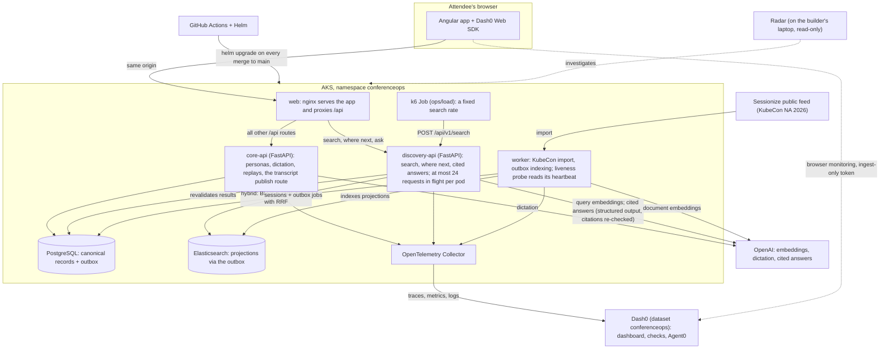
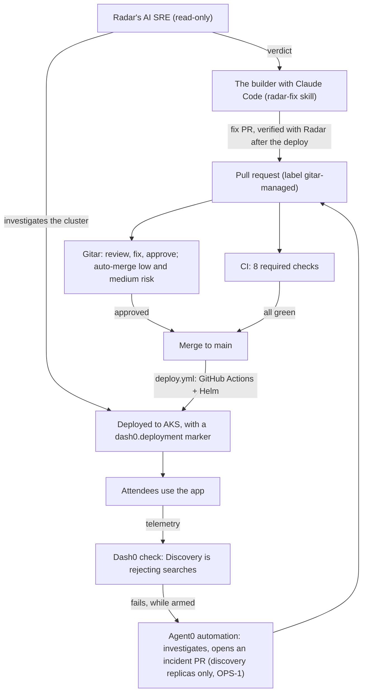

# ConferenceOps AI

Find the right conference talk, accessibly, on a platform with an AI operations team behind it:
Elasticsearch search, Dash0 observability with Agent0, Radar's AI SRE, and Gitar-reviewed delivery to Kubernetes.

> Built at the WeMakeDevs Cloud Native Hackathon, Salt Lake City, November 9, 2026, in one day, from an empty
> repository. Every number and link below was checked against the repository, the GitHub Actions runs or the public
> URL on November 9. Where something isn't finished, it says **pending**. Times are UTC.

## Status: what is live today


**Public URL: <http://conferenceops-ai.westus3.cloudapp.azure.com>** (AKS, plain HTTP). It serves the version
`38aefeb`, the merge of [#46](https://github.com/DSavaliya-Labs/conferenceops-ai/pull/46), deployed by
[run 42707593311](https://github.com/DSavaliya-Labs/conferenceops-ai/actions/runs/42707593311) at 21:59 (later merges
deploy in turn). Checked by hand at 22:03 UTC:

| On the public URL | Evidence |
|---|---|
| The attendee app (`GET /`) and its `/config.json` | dataset `conferenceops`, environment `aks`, version `38aefeb…` |
| Hybrid search over both events, `POST /api/v1/search` | "something about eBPF and security" → 10 results, `retrievalMode: hybrid`, from KubeCon and the fictional CloudBridge Summit |
| The persona switcher, `GET /api/v1/demo/profiles` | 8 personas, every one `isFictional: true` |
| "Where should I go next?", `POST /api/v1/recommendations/next` | as Aisha: `status: matches`, 5 cards with checkable reasons, 74 talks excluded as `NO_MATCH`, the step-free warning with its source link; an unknown profile gets `404` |
| Admission control on discovery (#32, #36) | one hand-sent search was answered `503 {"code":"DISCOVERY_CAPACITY_EXHAUSTED","retry_after_seconds":1,…}` while the pod was at its limit; the next one got 200 |
| Cited answers from published transcripts, `POST /api/v1/ask` | "What did the AI SRE agent get wrong at CloudBridge?" → a two-sentence answer with 2 citations into "AI SRE in Practice: What Our Agent Got Wrong", `retrievalMode: hybrid`, `isFictional: true` |
| Captioned replays | `/media/cloudbridge/clip-1.mp4` (video/mp4, 570 KB) and `clip-1.vtt` (text/vtt), `manifest.json`; clips 2 and 3 alongside |
| Deploy on every merge, marked in Dash0 | 18 deploy runs by 22:05 UTC: 14 succeeded, 1 failed and was fixed by the next merge, 2 cancelled by a newer merge, 1 still running ([deploys](#deploys)) |

**Measured since the first version of this page:** the incident run and its recovery window (below), Radar's
verify step after #35, and the CloudBridge replays, transcripts and cited answers
([#37](https://github.com/DSavaliya-Labs/conferenceops-ai/pull/37), merged as `ec79843` at 21:49 and checked on the
public URL at 22:03). **Pending** (not claimed): the attendee portal UI pull request
([#50](https://github.com/DSavaliya-Labs/conferenceops-ai/pull/50)) and a dictation demo on an HTTPS origin. Details
under each track and in [Known limitations](#known-limitations).

Live progress: the [Build log](https://github.com/DSavaliya-Labs/conferenceops-ai/issues/1) (issue #1, one entry per
closed pull request) and the
[pull request list](https://github.com/DSavaliya-Labs/conferenceops-ai/pulls?q=is%3Apr) with Gitar's reviews.

## What it does

ConferenceOps AI helps an attendee find the next talk worth their time, with honest accessibility information.

- **Two events on one platform.**
  - **KubeCon + CloudNativeCon North America 2026** is real. Its 600 sessions, speakers and rooms come from the
    event's public [Sessionize feed](https://sessionize.com/api/v2/svi82w6c/view/All), the one the
    [official schedule](https://events.linuxfoundation.org/kubecon-cloudnativecon-north-america/program/schedule/)
    embeds.
  - **CloudBridge Summit** is fictional and labeled as fictional wherever it appears. Set about a month in the past,
    its 24 sessions and 12 speakers hold the archive and give the eight demo personas a conference history.
  - Search covers both events, and every result names its event.
- **Two questions from one Ask bar.**
  - **"Which talk matches my interests?"** The query runs a hybrid search in Elasticsearch: BM25 keyword matching
    and kNN over OpenAI embeddings, with the same filters on both, fused with reciprocal rank fusion (RRF). If
    embeddings are unavailable, search falls back to keywords and says so.
  - **"Where should I go next?"** applies hard rules before any ranking: the talk hasn't started on the venue's
    clock (`America/Denver`), falls in the chosen window (rest of today, tomorrow morning, or any time), is open to any
    attendee (not off-site, sold out, or behind a separate registration), isn't on or clashing with the attendee's
    agenda, isn't at a level they left out, and has published captioning for its room when they asked for captions.
    The talks that pass are ranked by the attendee's stated interests and their CloudBridge history and bookmarks,
    and every card says why, in reasons you can check. The answer is deterministic. A generated explanation (OpenAI,
    picking only from these cards, every ID checked, this answer as the fallback) isn't built yet.
  - **"Viewing as"** switches between the eight fictional demo personas. The server looks the persona up from the
    `X-Demo-Profile-ID` header and trusts nothing else the browser says about her; it is a demo switch, not a
    sign-in.
- **Honest accessibility facts.** Only what the official KubeCon
  [Inclusion + Accessibility page](https://events.linuxfoundation.org/kubecon-cloudnativecon-north-america/attend/inclusion-accessibility/)
  publishes (read on November 6, 2026), each shown with its source link: Wordly captioning, reserved seating, quiet
  rooms, a prayer room, wheelchair and scooter rental, and staff help with elevators and other accessibility
  questions. Captioning and reserved seating are stated only for talks in the event's session rooms; on the expo
  floor, in public areas and off-site they're shown as not published. No event here has route data, so nothing is
  ever labeled step-free. An attendee who needs step-free routes is told that routes aren't published, and to ask
  Linux Foundation staff at the registration or information desks.
- **Real speakers' words stay theirs.** No transcript, quote or live text is ever generated for a real KubeCon
  speaker.
- **Spoken questions.** The microphone next to the Ask bar records up to 60 seconds; `core-api` sends the recording
  to OpenAI's `gpt-transcribe` and the text lands in the Ask bar for review. Nothing is searched until you press
  Search. A denied microphone or a failed transcription says so, and typing keeps working. The audio is never stored,
  and neither it nor the text reaches logs or telemetry. Browsers allow the microphone only on HTTPS or `localhost`,
  and the public URL is plain HTTP today, so dictation works on a local or port-forwarded instance.
- **Knowledge after the talk,** on the fictional CloudBridge Summit only. Three concluded sessions have a captioned
  replay: a simulated excerpt (text written for the demo, read by an OpenAI voice over a title slide, labeled as
  such everywhere) with WebVTT captions timed from the generated audio. A question in the Ask bar is answered from
  **published** transcripts only, by an OpenAI model that may use nothing but the retrieved passages; every citation
  is checked against the database and links to the replay at that moment, and a slow or failed model call falls
  back to the best-matching passage, marked as not model-written. A transcript that is still processing says so on
  its replay page and is neither searchable nor citable until an organizer publishes it
  (`POST /api/v1/ops/transcripts/{session_id}/publish`, organizer persona required), and even then only once the
  worker has projected it into Elasticsearch.
- **An AI operations team.** Dash0 watches what attendees experience. When a check fails, Agent0 investigates and
  opens a fix pull request, Gitar reviews it, and GitHub Actions deploys it to AKS once it merges. Radar's AI SRE
  investigates the cluster. See [the operations loop](#the-operations-loop).

## Evidence by track

### Gitar: never merge broken

Every change after the bootstrap commit went through a pull request that Gitar reviewed. By 21:30, 34 pull requests
had been opened: 25 merged, 8 closed without merging (replaced, see the gotcha), 1 held open as evidence. More are
open since; the pull request list is live.

| What | Where |
|---|---|
| The Build log: 32 entries so far, each with Gitar's verdict, risk, rules and the CI result | [issue #1](https://github.com/DSavaliya-Labs/conferenceops-ai/issues/1), written by [`scripts/build-log.sh`](scripts/build-log.sh) |
| Gitar's configuration: review instructions, rules, and the risk, apply, approve and merge criteria | [`.gitar/`](.gitar), [`.gitar/config/risk.md`](.gitar/config/risk.md) |

**Real findings Gitar found and fixed, with tests.** The builder checked each fix and kept it:

| PR | Gitar's finding | Gitar's fix |
|---|---|---|
| [#2](https://github.com/DSavaliya-Labs/conferenceops-ai/pull/2) | FastAPI's request spans carried the full query string (`http.url`): what an attendee typed would have reached Dash0 (PRIV-1) | [`29da8e8`](https://github.com/DSavaliya-Labs/conferenceops-ai/commit/29da8e8) redacts it, with a test |
| [#2](https://github.com/DSavaliya-Labs/conferenceops-ai/pull/2) | The CI readiness loop passed even when `/health/ready` never answered | the same commit fails the step after the loop |
| [#3](https://github.com/DSavaliya-Labs/conferenceops-ai/pull/3) → [#20](https://github.com/DSavaliya-Labs/conferenceops-ai/pull/20) | Concurrent upserts could write the same revision for different content (DATA-1); then the row lock still left a first-insert race | [`23d153e`](https://github.com/DSavaliya-Labs/conferenceops-ai/commit/23d153e) locks the row, [`db5e6fe`](https://github.com/DSavaliya-Labs/conferenceops-ai/commit/db5e6fe) handles the insert race, both with integration tests |
| [#5](https://github.com/DSavaliya-Labs/conferenceops-ai/pull/5) → [#23](https://github.com/DSavaliya-Labs/conferenceops-ai/pull/23) | Migrations ran as a post-upgrade hook, after the new pods already served the old schema; `postgres:17` was a floating tag (K8S-1); the chart's render-guard CI steps passed on any render failure | [`fc5177a`](https://github.com/DSavaliya-Labs/conferenceops-ai/commit/fc5177a): pre-upgrade hook, pinned PostgreSQL, guards that assert the expected message |
| [#7](https://github.com/DSavaliya-Labs/conferenceops-ai/pull/7) | nginx wouldn't start when the API upstream names can't be resolved: the container exited in CI, and would crash-loop on Kubernetes until the Services exist | [`fe358b8`](https://github.com/DSavaliya-Labs/conferenceops-ai/commit/fe358b8) resolves the names per request |

**A Gitar fix that was wrong, and the correction.** `fe358b8` hardcoded nginx's resolver to `127.0.0.11`, Docker's
embedded DNS, which doesn't exist in a Kubernetes pod: on AKS every `/api/` request would have returned 502. The
builder's [`c2d301c`](https://github.com/DSavaliya-Labs/conferenceops-ai/commit/c2d301c) takes the resolver from
`/etc/resolv.conf`, fully qualifies the upstream names, and adds a CI check that an unresolvable API name fails only
that request while nginx keeps serving. Gitar re-checked the template and confirmed the correction
[in the thread](https://github.com/DSavaliya-Labs/conferenceops-ai/pull/7). Rule for the day: review Gitar's commits.

**The blocked pull request.** [#28 "Faster venue times: a fixed Mountain offset"](https://github.com/DSavaliya-Labs/conferenceops-ai/pull/28)
is a planted TIME-1 defect, disclosed in the PR, to test the gate. CI passed (the only test checks a November date).
Gitar requested changes with one inline finding on `search.py:24`: a fixed UTC-7 shows the October CloudBridge
sessions an hour early and labels them MST, and the claimed speedup isn't real because `ZoneInfo` is a cached
module-level constant. It is held with `do-not-merge`, still open, and will be closed without merging. Nothing from
that branch ships.

**Who merged what.** Gitar auto-merged the low- and medium-risk pull requests whose base was `main`:
[#10](https://github.com/DSavaliya-Labs/conferenceops-ai/pull/10), [#12](https://github.com/DSavaliya-Labs/conferenceops-ai/pull/12),
[#13](https://github.com/DSavaliya-Labs/conferenceops-ai/pull/13), [#14](https://github.com/DSavaliya-Labs/conferenceops-ai/pull/14),
[#16](https://github.com/DSavaliya-Labs/conferenceops-ai/pull/16), [#18](https://github.com/DSavaliya-Labs/conferenceops-ai/pull/18),
[#19](https://github.com/DSavaliya-Labs/conferenceops-ai/pull/19). The builder merged the rest after Gitar's
approval: the high-risk ones (#2, #6, #7, #20, #21, #22, #23, #24, #26, #27, #29, #30, #34) and five medium-risk
ones merged by hand (#15, #31, #32, #35, #36). The Build log shows the risk of each.

**The approval gotcha.** Gitar submits its GitHub approval once per pull request, and branch protection dismisses
approvals on every push, rebase or retarget, and Gitar doesn't approve again. Eight pull requests were closed without
merging for that reason and replaced by a fresh pull request from the same branch: #3 → #20, #5 → #23, #8 → #21,
#9 → #24, #11 → #22, #17 → #25 → #27 and #33 → #35. The Build log lists each as "closed without merging".

### Dash0 and Agent0

Everything Dash0 is code in [`observability/dash0/`](observability/dash0) (dataset `conferenceops`), applied by
[`scripts/dash0-apply.sh`](scripts/dash0-apply.sh) ([#13](https://github.com/DSavaliya-Labs/conferenceops-ai/pull/13),
[#18](https://github.com/DSavaliya-Labs/conferenceops-ai/pull/18)).

| What | Evidence |
|---|---|
| Deploy markers | [`deploy.yml`](.github/workflows/deploy.yml) sends a `dash0.deployment` event for `web`, `core-api`, `discovery-api` and `worker` after each rollout, with `service.version` = the commit, `deployment.environment.name=aks`, `deployment.status=succeeded`; seen in Dash0 with exactly those attributes for `core-api`, `discovery-api` and `worker` |
| Traces without query text (PRIV-1) | discovery-api server spans `POST /api/v1/search` carry an empty `url.query`; their child `search` spans carry `db.system.name=elasticsearch`; no span, log or metric label holds what the attendee typed |
| Latency seen from both sides | during the 32 requests/s step, Dash0's p95 of `POST /api/v1/search` was 0.30–0.37 s; k6 measured 357 ms |
| Dashboard **ConferenceOps: attendee impact** | [`dashboards/attendee-impact.yaml`](observability/dash0/dashboards/attendee-impact.yaml): discovery requests by status, 5xx share, p95, per-pod traffic and 503s, Elasticsearch calls, core API, browser vitals, Kubernetes replicas and restarts. Its label names were checked on live data at 21:09: `k8s_pod_name` on spans, `k8s.deployment.available` for all five Deployments, `dash0.web.page_views` = 7 for service `web` |
| Check **Discovery is rejecting searches** (critical) | [`checks/discovery-rejecting-searches.yaml`](observability/dash0/checks/discovery-rejecting-searches.yaml), id `7f910f6b…`: more than 10% 5xx over a minute with at least 100 requests, two evaluations in a row. **0 failed evaluations during the whole capacity baseline**, 4 to 128 requests/s: the overload produced client timeouts, not 5xx, so the check stayed quiet. No false positive |
| Check **Search is slow** (degraded) | [`checks/search-is-slow.yaml`](observability/dash0/checks/search-is-slow.yaml): p95 above 1.5 s for two minutes |
| A bug found by running the rule against live data | [#31](https://github.com/DSavaliya-Labs/conferenceops-ai/pull/31): the live spans carried the old `http_status_code` label, so the rule's `http_response_status_code` matcher counted nothing, and the incident could never have fired. Fixed at the source (`OTEL_SEMCONV_STABILITY_OPT_IN=http`, a regression test that fails without it) and verified at 21:12: fresh discovery spans carry `http_request_method=POST` and `http_response_status_code=200` |
| Agent0 automation **ConferenceOps: fix discovery capacity** | [`automations/discovery-capacity-fix.json`](observability/dash0/automations/discovery-capacity-fix.json) and [its prompt](observability/dash0/automations/discovery-capacity-fix.prompt.md): triggers on that one check, may change only the discovery replicas or resources in `deploy/env/aks/values.yaml` (OPS-1), 50 credits a day, one run at a time. **Disarmed** until the incident run: `scripts/dash0-apply.sh --arm` right before it. Dash0's GitHub integration covers this repository (checked on November 9) |

**The incident run (November 9, 21:27–21:52 UTC).** The k6 Job offered 80 requests/s to one discovery pod with the
measured limit of 24 in flight, and the offered load never changed (OPS-1):

| Time (UTC) | What happened | Evidence |
|---|---|---|
| 21:27:52 | Load starts: 80 /s against `conferenceops-discovery` (1 replica) | k6 summary; Dash0 spans: 21:29 minute 3,448 OK / 1,297 rejected (27%) |
| 21:29:06 | Check **Discovery is rejecting searches** fails (critical, observed 26.6%) | Dash0 failed check `14477624050445699180` |
| 21:34:45–21:38:59 | Agent0 investigates with the automation's prompt: every 5xx is a `DISCOVERY_CAPACITY_EXHAUSTED` 503 from the only pod at 24/24 slots (~21–22 rejections/s), one pod accepts ~58.5 /s, Elasticsearch ~14 ms and 0 errors, OpenAI 200s, replicas 1/1 with 0 restarts; verdict **admission saturation**, fix replicas 1 → 3 (80 ÷ 58.5 = 1.37 → 2, plus one of headroom) | Agent0 thread `c06494a3-10e3-42b6-920c-77b9da256473` (Dash0 org members) |
| 21:44:06 | Incident PR [#44](https://github.com/DSavaliya-Labs/conferenceops-ai/pull/44) opened with Agent0's diff and description, labels `incident` and `gitar-managed` | [#44](https://github.com/DSavaliya-Labs/conferenceops-ai/pull/44) |
| 21:46:40 | Gitar approves; the `incident-scope` check passes (only `components.discovery.replicas` changed) | #44 checks and review |
| 21:46:47 | Merged (72b5693); deploy run starts 21:46:56 | [run 42705719050](https://github.com/DSavaliya-Labs/conferenceops-ai/actions/runs/42705719050) |
| ~21:48:45 | `conferenceops-discovery` at 3/3 ready; the three new pods each serve 1,591–1,628 requests/min | Dash0 `sum by (k8s_pod_name)` on `dash0.spans` |
| 21:50 and 21:51 | **Recovery window:** 4,802 requests/min, 0 5xx, p95 0.33 s in each minute (one pod under the same load: 0.60 s with 27% rejected) | Dash0 per-minute queries on `POST /api/v1/search` |
| 21:50:06 | The check resolves: 21 minutes from failure to recovery, 6 minutes from the PR to recovery | Dash0 failed checks |

Two honest notes. The armed automation did **not** start a run for this failure: Dash0 reused the issue identifier
from the 21:22 calibration failure, so no `failed_check.new` event was raised. The plan's fallback was used: the
builder started Agent0 by hand through the Dash0 MCP with the automation's own prompt, and, because GitHub is
read-only over that connection and no PR appeared from the thread within three minutes, pushed Agent0's pull
request unchanged as #44, crediting the thread in its body. The review, the merge, the deploy and the recovery
measurement are exactly the loop the plan describes; the trigger is the part to fix next (a fresh issue, or a
`failed_check` trigger that also fires on re-opened issues).

### Radar: AI SRE, read-only

Radar 1.20.1 runs on the builder's laptop against the AKS cluster, read-only (`-mcp-read-only -disable-exec
-disable-helm-write`), so its run links are local to that machine. The bridge to Git is
[`scripts/radar-investigate.sh`](scripts/radar-investigate.sh) and the
[`radar-fix`](.claude/skills/radar-fix/SKILL.md) Claude Code skill
([#12](https://github.com/DSavaliya-Labs/conferenceops-ai/pull/12),
[#19](https://github.com/DSavaliya-Labs/conferenceops-ai/pull/19)): a verdict is untrusted text, it is posted to a
pull request neutralized, and never patches the live cluster.

| Investigation (safeguarded profile, Claude Code as the agent) | Verdict |
|---|---|
| `deployment/conferenceops-worker`, run `run-daceea5bca` | healthy, certainty established, confidence 0.85. The real finding: the worker had no probes, so a hung loop would look healthy forever; the CPU limit is absent by design |
| `deployment/conferenceops-discovery`, run `run-f56d7ea03f` | healthy, confidence 0.93. Posture: one replica, no CPU limit; the readiness failures in the events were startup noise |

The finding became [#35](https://github.com/DSavaliya-Labs/conferenceops-ai/pull/35) (first opened as #33, replaced
after the approval gotcha): each worker loop writes a heartbeat under `/tmp`, and the chart's liveness probe reads only
that, so a hung worker is restarted instead of looking healthy. Merged at 21:11 and deployed by
[run 42700125904](https://github.com/DSavaliya-Labs/conferenceops-ai/actions/runs/42700125904). The PR body quotes
Radar's evidence and what it ruled out.

**Verify step, done.** After #35 deployed, `scripts/radar-investigate.sh --verify 35 deployment/conferenceops-worker
-n conferenceops` ran Radar again (run `run-dd944424fc`, 21:24–21:26 UTC): **healthy**, certainty established,
confidence 0.9, "running normally on its newest image, with no restarts or errors"; the `livenessProbeMissing`
finding no longer appears. The verdict is posted on
[#35](https://github.com/DSavaliya-Labs/conferenceops-ai/pull/35#issuecomment-6751877278).

### Elasticsearch

| What | Evidence |
|---|---|
| Two events indexed through the outbox | 600 real KubeCon sessions from the live Sessionize feed plus the 24 fictional CloudBridge sessions: 624 outbox jobs done. Import: [#21](https://github.com/DSavaliya-Labs/conferenceops-ai/pull/21); seed: [#22](https://github.com/DSavaliya-Labs/conferenceops-ai/pull/22), [#27](https://github.com/DSavaliya-Labs/conferenceops-ai/pull/27) |
| Hybrid search | [#24](https://github.com/DSavaliya-Labs/conferenceops-ai/pull/24): BM25 and kNN (`text-embedding-3-small`, 1,536 dimensions) with identical filters, fused in Python with RRF (`1 / (60 + rank)`), revalidated against PostgreSQL before the browser sees them |
| The golden query | "something about eBPF and security" on the public URL at 21:28: 10 hybrid results from both events, among them the fictional "Kernel Eyes: Watching Every Syscall Without Slowing Down", whose title names neither eBPF nor security (ninth today) |
| Honest fallback | when the query embedding fails, search answers in `lexical` mode and says so: 1 of 3,841 requests during the 64 requests/s step |

### Accessibility (Merge Forward)

| What | Evidence |
|---|---|
| Honest access facts, with sources | the seven facts of the official Inclusion + Accessibility page, each with its link: captioning (Wordly), reserved seating, two quiet rooms, a prayer room, staff help with elevators, wheelchair and scooter rental ([`kubecon.py`](backend/conferenceops/kubecon.py), `ACCESS_FACTS`). Each "where next" card lists the published facts that apply to it, with their status and source |
| Nothing step-free | no event has route data, so nothing is labeled step-free. "Where next" returns the warning `STEP_FREE_NOT_PUBLISHED` with the page's URL and tells the attendee to ask Linux Foundation staff (observed live as Aisha) |
| Hard rules first | [#30](https://github.com/DSavaliya-Labs/conferenceops-ai/pull/30): venue clock, window, agenda clashes, level, and captions when asked for, before any ranking; reasons `INTEREST_MATCH`, `HISTORY_MATCH` ("Similar to … which you attended at CloudBridge Summit 2026"), `BOOKMARK_MATCH`, `CAPTIONS_PUBLISHED` on every card |
| Keyboard-first app | a skip link, labels, one polite live region ([`app.html`](apps/web/src/app/app.html)), tested in Vitest and in the `ui-smoke-accessibility` CI job; [#7](https://github.com/DSavaliya-Labs/conferenceops-ai/pull/7), [#34](https://github.com/DSavaliya-Labs/conferenceops-ai/pull/34) |
| Spoken questions | [#34](https://github.com/DSavaliya-Labs/conferenceops-ai/pull/34) merged and deployed; the audio and the text never reach logs or spans. A demo on an HTTPS origin: **pending** (the public URL is HTTP, so browsers won't grant the microphone there) |
| Captioned replays | [#37](https://github.com/DSavaliya-Labs/conferenceops-ai/pull/37) merged and deployed: three CloudBridge sessions have a replay with WebVTT captions on by default, a pause control and the transcript panel, each labeled "Simulated excerpt" and fictional; clip 3 starts unpublished and is neither searchable nor citable until an organizer publishes it |

### Capacity: measured, then enforced

One discovery pod, no admission control yet, a k6 Job inside the cluster against the ClusterIP Service
([`ops/load/`](ops/load), [#14](https://github.com/DSavaliya-Labs/conferenceops-ai/pull/14)), 60 s per step,
20:41–20:54, on image `05884ad` up to the 64 /s step and `4da0ba2` after the #30 rollout:

| Offered rate | Sent | Failed | p95 of successful requests | Result |
|---|---|---|---|---|
| 4 /s | 241 | 0 | 353 ms | pass, all hybrid |
| 8 /s | 480 | 0 | 304 ms | pass |
| 16 /s | 961 | 0 | 308 ms | pass |
| 32 /s | 1,920 | 0 | 357 ms | pass |
| 64 /s | 3,841 | 0 | 411 ms | pass, 1 lexical fallback |
| 96 /s, first run | 5,034 | 65.4% | 9.3 s | overlapped the #30 rollout: discarded |
| 96 /s, re-run | 5,093 | 23.3% (1,164 timeouts, 667 dropped iterations) | 9.0 s | fail |
| 128 /s | 6,694 | 69.2% | 8.2 s | fail; the pod was restarted |

- **C_pod = 64 requests/s**, the highest rate that met every target. At 96 /s the saturated pod stopped answering its
  probes: Kubernetes logged "Readiness probe failed: context deadline exceeded" (×14, 20:53:21), "Liveness probe
  failed" (×7) and "Container discovery failed liveness probe, will be restarted" (×2, 20:54:13); the pod restarted
  twice. Without admission control, overload turned into a restart, not a fast 503.
- **The limit, from the measurement.** [#32](https://github.com/DSavaliya-Labs/conferenceops-ai/pull/32) added a
  per-pod limit on requests in progress ([`admission.py`](backend/conferenceops/admission.py)): above it, an immediate
  `503 DISCOVERY_CAPACITY_EXHAUSTED` with `Retry-After: 1`, recorded on the span, in a metric and in one log line;
  health probes are never limited. It shipped with the placeholder 8;
  [#36](https://github.com/DSavaliya-Labs/conferenceops-ai/pull/36) set it to **24** by Little's law (64 requests/s ×
  about 0.38 s), leaving 16 of the 40 worker threads for the probes ([`values.yaml`](deploy/env/aks/values.yaml)).
  The `incident-scope` check rejects any change to the limit on an incident pull request (OPS-1).
- **Calibration after #36 deployed** (21:18–21:22, 90 s each, from the k6 summaries kept by the builder): 64 /s →
  5,760 sent, 14 rejected with `DISCOVERY_CAPACITY_EXHAUSTED` (0.24%), p95 432 ms, every target met; 80 /s → 7,201
  sent, 1,860 rejected (25.8%), no timeouts, no dropped iterations, p95 of the accepted requests 638 ms. The pod
  stayed up through both runs: 0 restarts (`kubectl get pods` after each run), unlike the unlimited pod at 96 /s.
- **The offered peak** for the incident is derived in [`ops/load/README.md`](ops/load/README.md): `T_max` = 21
  talks starting in the same minute (measured from the feed), the rest assumptions; the incident needs
  `1.2 × C_pod ≤ R_test`, so about **80 requests/s**.

## Deploys

Every merge to `main` builds both images and runs `helm upgrade` on AKS
([`deploy.yml`](.github/workflows/deploy.yml); Azure sign-in through OIDC, no stored Azure secret), checks that the
public URL serves the app, its config and a search, and marks the deploy in Dash0. Twelve deploy runs today: ten
succeeded, one failed and was fixed by the next merge, one was cancelled (#14's, while #24 was merging):

| Run | Commit | What happened |
|---|---|---|
| [42689455365](https://github.com/DSavaliya-Labs/conferenceops-ai/actions/runs/42689455365) | `0686b42` (#23) | the first deploy: success, the public URL answered, Dash0 markers sent |
| [42689793435](https://github.com/DSavaliya-Labs/conferenceops-ai/actions/runs/42689793435) | `81f1d24` (#24) | **failed**: Helm's server-side apply conflicted with the ECK operator, which owns `.spec.nodeSets` of the Elasticsearch object |
| [42692058039](https://github.com/DSavaliya-Labs/conferenceops-ai/actions/runs/42692058039) | `a2a9645` (#26) | the fix, `--server-side=true --force-conflicts`: "Upgrade complete", revision 3 |
| [42693352199](https://github.com/DSavaliya-Labs/conferenceops-ai/actions/runs/42693352199) | `31f8a46` (#27) | the seed hook Job completes after the migrations: 24 sessions, 12 speakers, 39 profiles |
| [42695783323](https://github.com/DSavaliya-Labs/conferenceops-ai/actions/runs/42695783323) | `05884ad` (#29) | the web app on the public URL: "serves the app, its config, and 10 search results" |
| [42696460473](https://github.com/DSavaliya-Labs/conferenceops-ai/actions/runs/42696460473) … [42700714281](https://github.com/DSavaliya-Labs/conferenceops-ai/actions/runs/42700714281) | `4da0ba2` (#30) to `cb3c5cf` (#36) | where next, stable semconv, admission control, the worker probe, dictation, the limit of 24: all green |
| [42705719050](https://github.com/DSavaliya-Labs/conferenceops-ai/actions/runs/42705719050) | `72b5693` (#44) | the incident fix: discovery 1 → 3 replicas, 3/3 ready about two minutes after the run started; recovery measured in Dash0 |
| [42706138032](https://github.com/DSavaliya-Labs/conferenceops-ai/actions/runs/42706138032) | `ec79843` (#37) | replays, transcripts and cited answers, deployed during the incident's recovery window without disturbing it (web and core rolled; discovery's values didn't change) |
| later | #39, #46, #47, #48 | each merge deployed in turn (the deploy workflow cancels a run when a newer merge starts) |

## Architecture



- **One Python package, three processes,** all from one image: `core-api` (personas, dictation, replays and the
  transcript publish route), `discovery-api` (search, "where should I go next?", cited answers) and `worker` (KubeCon import and outbox indexing, each in its own loop).
  Discovery is its own process so it can scale out under load while the rest keeps working.
- **PostgreSQL is canonical.** A write and its outbox job commit in one transaction. The worker turns outbox jobs
  into Elasticsearch documents, versioned by revision, so a late job never overwrites newer content.
- **Hybrid search** runs BM25 and kNN in Elasticsearch with identical filters, fuses the two rankings in Python with
  RRF (`1 / (60 + rank)`), and revalidates the results against PostgreSQL before they reach the browser.
- **Telemetry:** OpenTelemetry from every service, through the collector, to Dash0. The browser uses the Dash0 Web
  SDK with an ingest-only token. What attendees type never reaches telemetry or logs.
- **Delivery:** every merge to `main` builds images tagged with the commit SHA, deploys them to AKS with
  `helm upgrade --reset-values --server-side=true --force-conflicts`, checks the public URL, and marks the deploy in
  Dash0.

## Repository map

The full table is under "Layout" in [`AGENTS.md`](AGENTS.md).

| Path | What lives there |
|---|---|
| `apps/web/` | The Angular app, and the nginx container that serves it |
| `backend/` | One Python package (`conferenceops`) with the `core-api`, `discovery-api` and `worker` entry points, its Alembic migrations and tests |
| `contracts/` | The committed OpenAPI schema, and the TypeScript types generated from it |
| `deploy/` | The Helm chart, and the values deployed to AKS |
| `observability/dash0/` | Dash0 as code: the dashboard, the check rules, the Agent0 automation and the dataset's settings |
| `ops/load/` | The k6 capacity test and how the offered peak is derived |
| `scripts/` | Bash scripts: Azure setup, the platform, branch protection, the Build log, the incident-scope check, the Dash0 apply, the load runner, the Radar bridge |
| `.github/workflows/` | CI (the 8 required checks), the deploy to AKS, and the Build log |
| `.gitar/` | Gitar's review instructions, rules, and its risk, apply, approve and merge criteria |
| `.claude/skills/` | The `radar-fix` skill: a Radar verdict becomes a reviewed chart or values pull request |
| `docs/` | Material this README embeds, such as the public URL's QR code |
| `AGENTS.md` | The rules every agent and human follows here (ACCESS-1 to TEST-1). `CLAUDE.md` links to it |

## The operations loop



- **Ship.** Gitar reviews each pull request while CI runs. It merges only with Gitar's approval and all 8 checks
  green. Each deploy is marked in Dash0, so a change in behavior lines up with the deploy that caused it.
- **Notice and fix.** Dash0 receives traces, metrics and logs from every service, plus browser monitoring. When the
  rejection check fails and the automation is armed, Agent0 investigates the telemetry and opens a fix pull request,
  which goes through the same review and checks.
- **Investigate the cluster.** Radar's AI SRE investigation is read-only. The builder turns what it finds into a fix
  pull request with Claude Code, and the fix goes through the same review and checks.

## How changes land

- **Pull requests only.** After the first configuration commit (see below), `main` takes changes only through a pull
  request with Gitar's approval and the 8 required checks green: `quality`, `domain-tests`, `data-integration`,
  `api-contract`, `ui-smoke-accessibility`, `helm-policy`, `incident-scope` and `build-images`. A new push
  dismisses the approval. Merge commits only, and no force-pushes
  ([`scripts/protect-main.sh`](scripts/protect-main.sh)).
- **Gitar reviews every pull request** against the rules in [`AGENTS.md`](AGENTS.md) and its instructions in
  [`.gitar/`](.gitar). With the `gitar-managed` label it can push fixes, and the builder checks them.
- **Risk decides who merges.** Gitar rates each pull request
  ([`.gitar/config/risk.md`](.gitar/config/risk.md)):
  - **low or medium:** once Gitar approves (no Critical or Important finding open), it arms auto-merge, and GitHub
    merges when the checks pass. Only pull requests into `main` auto-merge, never one layer of a stack into another;
  - **high** waits for the builder. A change to CI or deploy workflows, branch protection, Gitar's configuration,
    the rules in `AGENTS.md`, secrets, authentication or permission checks, the transcript publication boundary, how
    access facts are shown, or a migration that drops or rewrites data is high risk.
- **Incident fixes stay small.** An incident pull request (labeled `incident`, or opened by Agent0) may change only
  the discovery workload's replicas or resources in `deploy/env/aks/values.yaml`. The `incident-scope` CI check
  rejects changes to any other file and compares the parsed values; Gitar's incident rule reviews the values
  themselves, against the evidence in the description.
- **The [Build log](https://github.com/DSavaliya-Labs/conferenceops-ai/issues/1) records each one.** A workflow adds
  one entry per closed pull request, merged or closed without merging: when (and who merged it), Gitar's verdict and
  risk, and any CI failures on the way.

## Known limitations

- **No social features.** No posts, reposts, follows, notifications, moderation or image upload.
- **One incident.** The discovery capacity incident ran once, with its recovery measured (see Dash0 and Agent0).
  The automation's trigger didn't fire for it (issue identifier reused), so the investigation was started by hand
  with the same prompt. The secondary CPU incident from the plan isn't built.
- **The acceptance matrix isn't fully run.** The incident recovery window and Radar's verify step are measured;
  the k6 tooling tests aren't in CI, and the incident ran once, not repeatedly.
- **The planted defect stays open.** #28 is blocked by Gitar and held with `do-not-merge` as evidence; it will be
  closed without merging.
- **No generated explanations for "Where should I go next?":** it is the deterministic answer only. Cited answers
  exist for the fictional CloudBridge Summit's published transcripts only; KubeCon has no transcripts (SPEAKER-1).
- **Three replay clips.** The CloudBridge archive has three simulated excerpts (60–90 s each) with captions, not
  full talks; clip 3 starts unpublished to show the publication boundary.
- **Dictation needs HTTPS.** The public URL is plain HTTP, so the microphone works only on a local or port-forwarded
  instance.
- **Telemetry gaps.** OpenAI and PostgreSQL calls aren't traced (a failure there shows in discovery-api's logs), the
  dashboard doesn't separate admission rejections from other 503s, there are no CPU or memory panels, and no
  notification channel: nobody is paged.
- **Radar is local.** Its run links point at the builder's laptop; the verdicts are quoted in the pull requests.
- **Capacity numbers include OpenAI.** Search has no query-embedding cache, so the measured capacity includes the
  embedding round trip; the lexical fallback shows when that call fails.

## How to run it

```bash
cd backend && uv sync --python 3.12          # install (Python 3.12, locked by uv.lock)
uv run ruff check . && uv run ruff format --check .
uv run pytest -q                              # unit tests; no PostgreSQL, Elasticsearch or OpenAI needed
DATABASE_URL=postgresql+psycopg://... uv run alembic upgrade head   # apply migrations
DATABASE_URL=... uv run pytest -q -m integration                     # integration tests (real PostgreSQL)
uv run core-api                               # or discovery-api, worker; listens on :8080
docker build -t conferenceops-backend backend # one image; the Deployment picks the command
helm dependency build deploy/chart && helm template conferenceops deploy/chart -f deploy/env/aks/values.yaml \
  --set image.repository=x --set image.tag=y \
  --set web.image.repository=x --set web.image.tag=y   # render the chart as CI does
```

```bash
cd apps/web && npm ci
npx ng test --watch=false   # unit and accessibility tests (Vitest)
npx ng build                # production build into dist/web/browser
docker build -t conferenceops-web apps/web   # nginx (unprivileged, :8080) serving the app, /config.json and the /api proxy
# Run it as AKS does: a read-only root, where only the chart's two emptyDir paths are writable
docker run --read-only --tmpfs /etc/nginx/conf.d:mode=0777 --tmpfs /tmp:mode=0777 -p 8081:8080 conferenceops-web
```

Dash0 as code, the capacity test and the Radar bridge have their own instructions:
[`observability/dash0/README.md`](observability/dash0/README.md), [`ops/load/README.md`](ops/load/README.md) and
[`.claude/skills/radar-fix/SKILL.md`](.claude/skills/radar-fix/SKILL.md).

**Reset the demo data.** Every deploy runs the seed Job, which only adds what is missing and never changes a row that
exists, so a deploy never reverts what the personas did. The full reseed is run by hand, never by a deploy:

```bash
cd backend && DATABASE_URL=postgresql+psycopg://... uv run python -m conferenceops.cloudbridge --reset
```

On AKS, run the same loader in a backend pod, which already has `DATABASE_URL`:
`kubectl -n conferenceops exec deploy/conferenceops-core -- python -m conferenceops.cloudbridge --reset`. A reset
deletes CloudBridge rows that aren't in the fixture and restores the personas' history, bookmarks and preferences;
KubeCon data and the worker's import are untouched.

## How this repository started

This first configuration commit went straight to `main`: this README, `AGENTS.md`, the Gitar configuration, CI and
the Build log. Branch protection was switched on right after it. From then on, every change needs a pull request,
green checks and Gitar's approval.

## What was prepared before the event

The hackathon rules allow ideas, notes, sketches and research before the start. Before November 9 we prepared:

- a written plan, a task list, and a sketch of the fictional demo event's content (notes);
- research: reading the sponsors' documentation and trying how their tools behave, in throwaway places;
- accounts, trials, API keys and installed tools: Gitar, Dash0, Radar, Azure, the Angular CLI, k6.

No project code or configuration was written before the start.

## AI use (disclosure)

- The builder writes the code with **Claude Code** (Anthropic) as the AI coding assistant; Codex is available as
  an alternative.
- **Gitar** reviews every pull request, can push fixes, approves, and auto-merges low- and medium-risk changes.
- **Agent0** (Dash0) investigates production telemetry and can open fix pull requests.
- **Radar's** AI investigations run through Claude Code in a read-only mode.
- The product itself uses **OpenAI** models: embeddings, dictation and the cited answers (Responses API with
  structured output, every citation re-checked against the database).

## License

Apache-2.0
