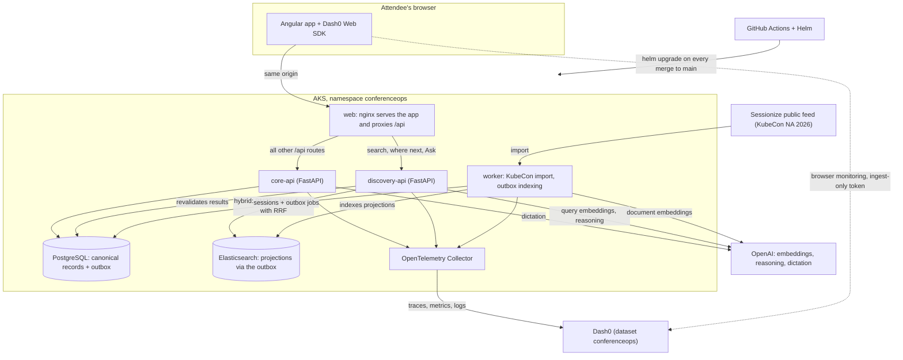
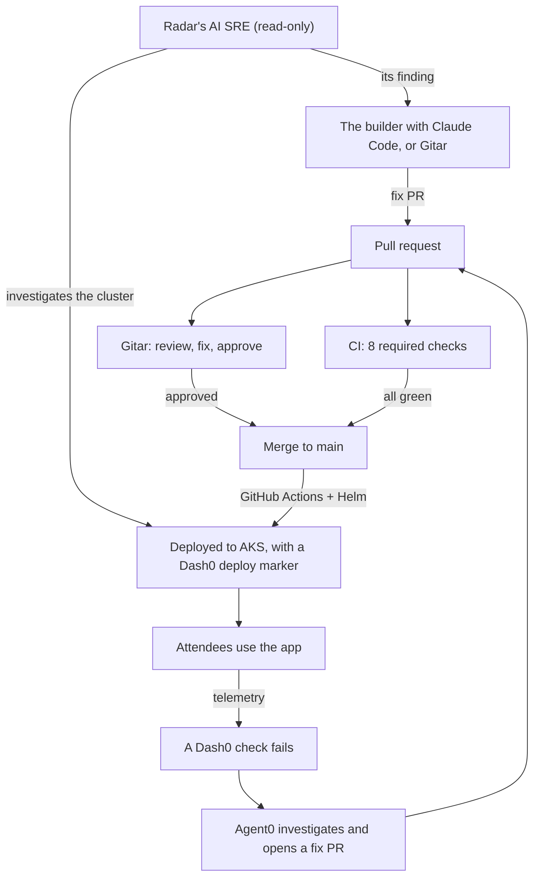

# ConferenceOps AI

Find the right conference talk, accessibly, on a platform with an AI operations team behind it:
Elasticsearch search, Dash0 observability with Agent0, Radar's AI SRE, and Gitar-reviewed delivery to Kubernetes.

> Built at the WeMakeDevs Cloud Native Hackathon, Salt Lake City, November 9, 2026. Work in progress: see
> [Status](#status).

## Status

**Being built today, November 9, 2026.** Nothing here is claimed as working in production until the deploy evidence
is in this README. Until then, "What it does", "Architecture" and "The operations loop" describe the design being
built, not a running service. "How changes land" is already how this repository works.

Live progress:

- the [Build log](https://github.com/DSavaliya-Labs/conferenceops-ai/issues/1) (issue #1): one entry per closed pull
  request;
- the [pull request list](https://github.com/DSavaliya-Labs/conferenceops-ai/pulls?q=is%3Apr), open and merged,
  with Gitar's reviews.

## What it does

ConferenceOps AI helps an attendee find the next talk worth their time, with honest accessibility information.

- **Two events on one platform.**
  - **KubeCon + CloudNativeCon North America 2026** is real. Its sessions, speakers and rooms come from the event's
    public [Sessionize feed](https://sessionize.com/api/v2/svi82w6c/view/All), the one the
    [official schedule](https://events.linuxfoundation.org/kubecon-cloudnativecon-north-america/program/schedule/)
    embeds.
  - **CloudBridge Summit** is fictional and labeled as fictional wherever it appears. Set about a month in the past,
    it holds the archive and gives the demo personas a conference history.
  - Search covers both events, and every result names its event.
- **Two questions from one Ask bar.**
  - **"Which talk matches my interests?"** The query runs a hybrid search in Elasticsearch: BM25 keyword matching
    and kNN over OpenAI embeddings, with the same filters on both, fused with reciprocal rank fusion (RRF). If
    embeddings are unavailable, search falls back to keywords and says so.
  - **"Where should I go next?"** applies hard rules before any ranking: the talk hasn't started on the venue's
    clock (`America/Denver`), falls in the chosen window (rest of today, tomorrow morning, or any time), isn't on or
    clashing with the attendee's agenda, isn't at a level they left out, and has published captioning when they asked
    for captions. The talks that pass are ranked by the attendee's stated interests and their CloudBridge history and
    bookmarks, and every card says why, in reasons you can check. The answer is deterministic. A generated
    explanation (OpenAI, picking only from these cards, every ID checked, this answer as the fallback) isn't built
    yet.
  - **"Viewing as"** switches between the eight fictional demo personas. The server looks the persona up from the
    `X-Demo-Profile-ID` header and trusts nothing else the browser says about her; it is a demo switch, not a
    sign-in.
- **Honest accessibility facts.** Only what the official KubeCon
  [Inclusion + Accessibility page](https://events.linuxfoundation.org/kubecon-cloudnativecon-north-america/attend/inclusion-accessibility/)
  publishes (read on November 6, 2026), each shown with its source link: Wordly captioning, reserved seating, quiet
  rooms, a prayer room, wheelchair and scooter rental, and staff help with elevators and other accessibility
  questions. No event here has route data, so nothing is ever labeled step-free. An attendee who needs step-free
  routes is told that routes aren't published, and to ask Linux Foundation staff at the registration or information
  desks.
- **Real speakers' words stay theirs.** No transcript, quote or live text is ever generated for a real KubeCon
  speaker.
- **An AI operations team.** Dash0 watches what attendees experience. When a check fails, Agent0 investigates and
  opens a fix pull request, Gitar reviews it, and GitHub Actions deploys it to AKS once it merges. Radar's AI SRE
  investigates the cluster. See [the operations loop](#the-operations-loop).

## Architecture

The target design. Each part lands through its own pull request, and the
[pull request list](https://github.com/DSavaliya-Labs/conferenceops-ai/pulls?q=is%3Apr) shows which have merged.

- **One Python package, three processes,** all from one image: `core-api` (personas, agenda, session pages,
  dictation), `discovery-api` (search, "where should I go next?", Ask) and `worker` (KubeCon import and outbox
  indexing, each in its own loop). Discovery is its own process so it can scale out under load while the rest keeps
  working.
- **PostgreSQL is canonical.** A write and its outbox job commit in one transaction. The worker turns outbox jobs
  into Elasticsearch documents, versioned by revision, so a late job never overwrites newer content.
- **Hybrid search** runs BM25 and kNN in Elasticsearch with identical filters, fuses the two rankings in Python with
  RRF (`1 / (60 + rank)`), and revalidates the results against PostgreSQL before they reach the browser.
- **Telemetry:** OpenTelemetry from every service, through the collector, to Dash0. The browser uses the Dash0 Web
  SDK with an ingest-only token. What attendees type never reaches telemetry or logs.
- **Delivery:** every merge to `main` builds images tagged with the commit SHA, deploys them to AKS with
  `helm upgrade --reset-values` (Azure sign-in through OIDC, so no Azure secret is stored), checks the public URL,
  and marks the deploy in Dash0.

## Repository map

A path that isn't on `main` yet is still in an open pull request. The full table is under "Layout" in
[`AGENTS.md`](AGENTS.md).

| Path | What lives there |
|---|---|
| `apps/web/` | The Angular app, and the nginx container that serves it |
| `backend/` | One Python package (`conferenceops`) with the `core-api`, `discovery-api` and `worker` entry points, its Alembic migrations and tests |
| `contracts/` | The committed OpenAPI schema, and the TypeScript types generated from it |
| `deploy/` | The Helm chart, and the values deployed to AKS |
| `scripts/` | Bash scripts, such as branch protection and the Build log |
| `.github/workflows/` | CI (the 8 required checks), the deploy to AKS, and the Build log |
| `.gitar/` | Gitar's review instructions, rules, and its risk, apply, approve and merge criteria |
| `AGENTS.md` | The rules every agent and human follows here (ACCESS-1 to TEST-1). `CLAUDE.md` links to it |

## The operations loop

- **Ship.** Gitar reviews each pull request while CI runs. It merges only with Gitar's approval and all 8 checks
  green. Each deploy is marked in Dash0, so a change in behavior lines up with the deploy that caused it.
- **Notice and fix.** Dash0 receives traces, metrics and logs from every service, plus browser monitoring. When a
  Dash0 check fails, an Agent0 automation investigates the telemetry and opens a fix pull request, which goes
  through the same review and checks.
- **Investigate the cluster.** Radar's AI SRE investigation is read-only. The builder turns what it finds into a fix
  pull request with Claude Code (or asks Gitar to write it), and the fix goes through the same review and checks.

## How changes land

- **Pull requests only.** After the first configuration commit (see below), `main` takes changes only through a pull
  request with Gitar's approval and the 8 required checks green: `quality`, `domain-tests`, `data-integration`,
  `api-contract`, `ui-smoke-accessibility`, `helm-policy`, `incident-scope` and `build-images`. A new push
  dismisses the approval. Merge commits only, and no force-pushes
  ([`scripts/protect-main.sh`](scripts/protect-main.sh)).
- **Gitar reviews every pull request** against the rules in [`AGENTS.md`](AGENTS.md) and its instructions in
  [`.gitar/`](.gitar). With the `gitar-managed` label it can push fixes, and the builder checks them.
- **Risk decides who merges.** Gitar rates each pull request
  ([`.gitar/config/risk.md`](.gitar/config/risk.md)):
  - **low or medium:** once Gitar approves (no Critical or Important finding open), it arms auto-merge, and GitHub
    merges when the checks pass. Only pull requests into `main` auto-merge, never one layer of a stack into another;
  - **high** waits for the builder. A change to CI or deploy workflows, branch protection, Gitar's configuration,
    the rules in `AGENTS.md`, secrets, authentication or permission checks, the transcript publication boundary, how
    access facts are shown, or a migration that drops or rewrites data is high risk.
- **Incident fixes stay small.** An incident pull request (labeled `incident`, or opened by Agent0) may change only
  the discovery workload's replicas or resources in `deploy/env/aks/values.yaml`. The `incident-scope` CI check
  rejects changes to any other file and checks the first key on each changed line; Gitar's incident rule reviews
  the values themselves, against the evidence in the description.
- **The [Build log](https://github.com/DSavaliya-Labs/conferenceops-ai/issues/1) records each one.** A workflow adds
  one entry per closed pull request, merged or closed without merging: when (and who merged it), Gitar's verdict and
  risk, and any CI failures on the way.

## How this repository started

This first configuration commit went straight to `main`: this README, `AGENTS.md`, the Gitar configuration, CI and
the Build log. Branch protection was switched on right after it. From then on, every change needs a pull request,
green checks and Gitar's approval.

## What was prepared before the event

The hackathon rules allow ideas, notes, sketches and research before the start. Before November 9 we prepared:

- a written plan, a task list, and a sketch of the fictional demo event's content (notes);
- research: reading the sponsors' documentation and trying how their tools behave, in throwaway places;
- accounts, trials, API keys and installed tools: Gitar, Dash0, Radar, Azure, the Angular CLI, k6.

No project code or configuration was written before the start.

## AI use (disclosure)

- The builder writes the code with **Claude Code** (Anthropic) as the AI coding assistant; Codex is available as
  an alternative.
- **Gitar** reviews every pull request, can push fixes, approves, and auto-merges low- and medium-risk changes.
- **Agent0** (Dash0) investigates production telemetry and can open fix pull requests.
- **Radar's** AI investigations run through Claude Code in a read-only mode.
- The product itself uses **OpenAI** models: reasoning, embeddings and dictation.

## License

Apache-2.0
