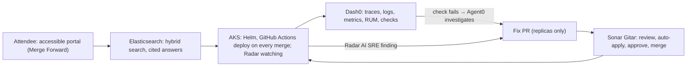

# ConferenceOps AI

**Find the right conference talk, accessibly, on a platform run by an AI operations team.**

| | |
|---|---|
| **Live** | https://conferenceops-ai.westus3.cloudapp.azure.com (self-signed certificate: accept the browser's warning once; `http://` serves too). QR code: [`docs/public-url-qr.svg`](docs/public-url-qr.svg) |
| **Repository** | https://github.com/DSavaliya-Labs/conferenceops-ai (public, Apache-2.0; every change after the first commit through a pull request) |
| **Demo video** | <https://drive.google.com/file/d/1z--UmAXog-8CFpAEAwu2y_A2Re4Zf2jG/view> |
| **Build log** | [Issue #1](https://github.com/DSavaliya-Labs/conferenceops-ai/issues/1): one entry per pull request with Gitar's verdict, risk and CI result |
| **Team** | Dhruv Savaliya (`DSavaliya-gh`), solo |
| **Event** | WeMakeDevs Cloud Native Hackathon, Salt Lake City, November 9, 2026 |
| **Tracks** | Sonar (Gitar) "Never Merge Broken", Dash0 "Stop Flying Blind", Radar "AI SRE", Elasticsearch "Find the Right Talk", Merge Forward "Conferences for Everyone" |

## Elevator pitch

KubeCon has 600 talks and 21 of them can start in the same minute. ConferenceOps AI answers the attendee's real
question, "where should I go next?", with only talks they can still reach, ranked by what they care about and what
they attended before, and it tells the truth about access: the facts the organizer publishes, with their links, and
"step-free routes aren't published; ask staff" instead of a guess. Behind it, an AI operations team keeps it up:
Dash0 sees attendees hurting, Agent0 writes the fix, Sonar's Gitar reviews and merges it, GitHub Actions deploys it
to AKS, and Radar's AI SRE watches the cluster.

## The problem

Conference schedules are huge, overlapping and written for organizers, not for the attendee standing in a hallway
with five minutes. Accessibility information is scattered, and apps that guess ("this room is accessible") are worse
than none. And a conference app gets its whole year's traffic in a few minutes before each session block, which is
exactly when it tends to fall over.

## What it does

- **Two events on one platform.** KubeCon + CloudNativeCon NA 2026 (real: 600 sessions imported from the official
  schedule's public feed) and the CloudBridge Summit (fictional, concluded a month earlier: 24 sessions, 8 demo
  personas, captioned replays and published transcripts; labeled fictional everywhere).
- **One Ask bar, two questions.** "Which talk matches my interests?" (hybrid search in Elasticsearch) and "Where
  should I go next?" (hard rules first, then ranking, with checkable reasons and the official access facts with their
  source links). Type or dictate the question.
- **Knowledge after the talk.** Captioned replays with a transcript panel; questions answered from published
  transcripts only, with citations that jump to the moment in the replay.
- **A portal that feels like a platform.** A persona menu at the top right (8 fictional demo personas; a first visit
  starts as Aisha Rahman), the Ask bar centered with Search, Where next? and the microphone inline, and a left
  navigation to every feature: Find talks, Where next, My agenda, Community, Events, Accessibility at the venue, How
  this platform runs.
- **Add to My Agenda and Read aloud on every talk card.** Read aloud uses an on-device voice only, so the text never
  leaves the device.
- **A community feed.** Posts and replies by the demo personas, with a seeded conversation; labeled as community
  content, never official information.
- **An AI operations team.** When attendees' searches start failing, Dash0's check fires, Agent0 investigates and
  writes the fix pull request, Gitar reviews and merges it, and the deploy brings the platform back, measured.

## How we built it

- **Web:** Angular 22 (zoneless, signals), keyboard-first, the Dash0 Web SDK for real-user monitoring.
- **APIs and jobs:** Python 3.12 and FastAPI (core-api, discovery-api, a worker), PostgreSQL 17 as the source of truth,
  Elasticsearch 9 (ECK) for search through an outbox.
- **AI:** OpenAI `text-embedding-3-small` for hybrid search, the Responses API with structured outputs for cited
  answers (every citation re-checked against server data, with a deterministic fallback), and transcription for
  dictation, always through the server.
- **Runtime and delivery:** AKS (Azure CNI overlay, Entra RBAC), a Helm chart, GitHub Actions with OIDC deploying on
  every merge, OpenTelemetry to Dash0 (traces, logs, metrics, Kubernetes events, deploy markers), k6 load tests in the
  cluster.
- **Sponsor tools as the workflow:** Sonar's Gitar on every pull request (project rules, auto-apply, approve and merge
  policy), Dash0 and Agent0 for the incident loop, Radar 1.20.1 read-only on the cluster with its AI SRE, all
  configuration as code in the repository.

## By the numbers (November 9, all measured)

| | |
|---|---|
| Pull requests merged | **43** between 10:51 AM and 4:56 PM MST, 40 after Gitar's approval |
| Deploys to AKS | **30** runs by 00:00 UTC, 27 succeeded, 1 failed and was fixed by the next merge, 2 cancelled by a newer merge |
| Incident | check failed 21:29:06 UTC at 26.6% errors; Agent0's fix (replicas 1 → 3) approved by Gitar 2½ minutes after it opened; recovery **4,802 requests/min, 0 5xx, p95 0.33 s**; check resolved 21:50:06 |
| Capacity | one discovery pod: **64 requests/s** at p95 411 ms; above that, admission control answers a fast 503 instead of a restart |
| Search | 624 sessions with 1,536-dimension embeddings; "something about eBPF and security" finds "Kernel Eyes", whose title never says eBPF |
| Tests | 252 backend unit tests plus PostgreSQL and Elasticsearch integration tests in CI; 95 web unit and accessibility tests |

## One pipeline, every tool

The incident on November 9 at 21:27–21:52 UTC went around this loop once, measured (details under Dash0).

## Track evidence, against the published criteria

### Sonar (Gitar): "Never Merge Broken"

- *"Gitar is part of how you built, with features landing through PRs it reviewed, not one PR at the end."* 43 PRs merged today; 40 merged after Gitar's approval, and one entry per PR is in [issue #1](https://github.com/DSavaliya-Labs/conferenceops-ai/issues/1) with Gitar's verdict, risk and the CI result. Low- and medium-risk PRs auto-merged after Gitar's approval; high-risk ones waited for the builder. Disclosed exception: three PRs at the code freeze, the community feed ([#64](https://github.com/DSavaliya-Labs/conferenceops-ai/pull/64)), the favicon ([#65](https://github.com/DSavaliya-Labs/conferenceops-ai/pull/65)) and the submission write-up ([#66](https://github.com/DSavaliya-Labs/conferenceops-ai/pull/66)), were merged with every CI check green but before Gitar's approval, by the builder's decision (Gitar had already pushed a fix to #64). The last PR of the day, an Ask bar alignment fix ([#67](https://github.com/DSavaliya-Labs/conferenceops-ai/pull/67)), went the normal way: Gitar found an edge case, pushed the fix, approved and merged it.
- *"Project-aware setup, with review instructions and repository rules that reflect how your team actually works."* [`AGENTS.md`](AGENTS.md) carries 14 rule IDs (PRIV-1, ACCESS-1, TIME-1, OPS-1, …) that findings cite; [`.gitar/review/`](.gitar/review) adds what is easy to miss here, a severity policy, and the codebase's engineering standards with their own `STD-` IDs (security, coding, design principles, API and data, testing and operations, delivery; [#62](https://github.com/DSavaliya-Labs/conferenceops-ai/pull/62)); [`.gitar/rules/`](.gitar/rules) (API client in sync, honest attendee facts, attendee privacy, incident scope, PR description, tests for behavior changes) and [`.gitar/config/`](.gitar/config) (risk, apply, approve, merge criteria). Incident PRs may change only the discovery replicas or resources: enforced by Gitar's rule and by the `incident-scope` CI check.
- *"Using CI failure diagnosis and auto-apply to fix real problems."* Real findings Gitar fixed with tests: a PRIV-1 span leak ([#2](https://github.com/DSavaliya-Labs/conferenceops-ai/pull/2), `29da8e8`), a CI health check that passed when it shouldn't, an upsert race and a first-insert race ([#3](https://github.com/DSavaliya-Labs/conferenceops-ai/pull/3)), the migration hook order and a floating image tag ([#5](https://github.com/DSavaliya-Labs/conferenceops-ai/pull/5)), nginx failing to start when upstreams don't resolve ([#7](https://github.com/DSavaliya-Labs/conferenceops-ai/pull/7)). One Gitar fix was wrong (Docker's DNS resolver on Kubernetes) and the builder corrected it in `c2d301c`: its commits are reviewed too. A planted defect, [#28](https://github.com/DSavaliya-Labs/conferenceops-ai/pull/28) (a fixed UTC offset), passed CI and was **blocked by Gitar** with the exact consequence; it is held open as evidence and never merged.

### Dash0: "Stop Flying Blind"

- *"Depth of instrumentation…"* OpenTelemetry on every service (traces with the query stripped, PRIV-1; structured logs with trace IDs; Kubernetes cluster metrics and events through the collector; browser monitoring with the Dash0 Web SDK: page views and web vitals from real visitors), deploy markers (`dash0.deployment`, succeeded or failed) on every deploy. [`observability/dash0/`](observability/dash0) holds the dashboard, two check rules and the Agent0 automation as code, applied idempotently by `scripts/dash0-apply.sh`.
- *"Using Agent0 or the MCP server to find and fix something real during the day…"* Two real finds. (1) Running the check rule's own PromQL against live data showed the spans carried the old `http_status_code` label: the rule could never fire; fixed at the source in [#31](https://github.com/DSavaliya-Labs/conferenceops-ai/pull/31) with a regression test. (2) **The incident.** A measured capacity test (one pod handles 64 requests/s, p95 411 ms; at 96/s it was restarted by its liveness probe) set the admission limit (24 in flight, [#36](https://github.com/DSavaliya-Labs/conferenceops-ai/pull/36)). At 80 requests/s the pod answered fast `503 DISCOVERY_CAPACITY_EXHAUSTED` and stayed healthy; the check **failed at 21:29:06 (26.6%)**; Agent0 investigated (every 5xx an admission rejection from the only pod at 24/24 slots, Elasticsearch ~14 ms with 0 errors, OpenAI 200s, replicas 1/1) and wrote the fix: replicas 1 → 3, sized from the evidence. [#44](https://github.com/DSavaliya-Labs/conferenceops-ai/pull/44) was approved by Gitar 2½ minutes later, merged, deployed; **21:50–21:51: 4,802 requests/min, 0 5xx, p95 0.33 s**, three pods serving; the check resolved at 21:50:06. Honest note: the automation's `failed_check.new` trigger didn't fire (Dash0 reused the issue id from the calibration failure), so the investigation was started by hand with the automation's own prompt and the PR pushed unchanged from Agent0's thread.
- *"Observability that's part of the product experience…"* The check is "attendees' searches are failing", the dashboard is "attendee impact", and the incident PR's acceptance is written as what attendees see (0 5xx for 60 s, p95 under 1.5 s).

### Radar (Skyhook): "AI SRE"

- *"Your project runs on Kubernetes with Radar connected to it."* AKS (Azure CNI overlay, Entra RBAC), Helm chart with the APIs, worker, PostgreSQL, Elasticsearch (ECK) and the collector; Radar 1.20.1 connected read-only (`-mcp-read-only -disable-exec -disable-helm-write`) with its own timeline.
- *"Using Radar's AI SRE to find and fix something real during the day…"* Radar's investigation of the worker (run `run-daceea5bca`, Claude Code as the agent, safeguarded profile) found it had no liveness probe: a hung worker would look healthy. The bridge ([`scripts/radar-investigate.sh`](scripts/radar-investigate.sh), the [`radar-fix`](.claude/skills/radar-fix/SKILL.md) skill) turned the verdict into [#35](https://github.com/DSavaliya-Labs/conferenceops-ai/pull/35): a heartbeat per loop and an exec probe; merged, deployed; `--verify` ran Radar again: **healthy, confidence 0.9**, posted on the PR. Radar never patched the cluster: the AI that reads the cluster can't change it, and the AI that writes the fix can't touch the cluster.

### Elasticsearch: "Find the Right Talk"

- *"Elasticsearch is the core data layer…"* PostgreSQL is canonical; Elasticsearch holds the searchable projections through an outbox with external versioning (a late event never resurrects hidden content). Two indexes: sessions (624 documents, 1,536-dimension embeddings) and published transcript chunks. ECK on the cluster.
- *"Smart use of search…"* Hybrid BM25 + kNN with the same filters on both channels, fused with reciprocal rank fusion in Python; lexical fallback when the model is slow (fail open). Golden query: "something about eBPF and security" returns "Kernel Eyes", whose title never says eBPF. The transcript boundary: only published transcripts are searchable or citable, enforced in the query and re-validated after retrieval; cited answers pick only from retrieved passages.

### Merge Forward: "Conferences for Everyone"

Honest access facts only (the seven the Linux Foundation publishes, each with its source link; nothing is ever labeled step-free; a hard requirement is never softened to fill a list); captioned replays with captions on by default, a pause control and a transcript panel; dictation for spoken questions (the public URL serves HTTPS since [#57](https://github.com/DSavaliya-Labs/conferenceops-ai/pull/57), which browsers require for the microphone); **Read aloud** on every talk card, Where-next card and the cited answer, with an on-device voice only so the text never leaves the device, and a disabled button that says why when there is none; **Add to My Agenda** as an `aria-pressed` toggle with its own polite status line, and a My agenda page that keeps focus and announces a removal ([#60](https://github.com/DSavaliya-Labs/conferenceops-ai/pull/60), checked live: `PUT` 204, `DELETE` 204, unknown talk 404); a community feed with labeled fields and one polite status line; a keyboard-first portal with visible focus, 44 px targets with consistent spacing, labels, restrained live regions, reduced-motion support and reflow to 320 px; two quiet rooms and the prayer room among the facts.

## Challenges we ran into

- **Approvals that disappeared.** GitHub dismisses an approval on every push or rebase, and Gitar approves a pull
  request once; more than a dozen pull requests had to be replaced by fresh ones from the same branch to be approved.
- **Helm against the Elasticsearch operator.** ECK owns part of the Elasticsearch object, so every Helm upgrade after
  the first failed with a server-side apply conflict; `--server-side=true --force-conflicts` fixed it (#26).
- **A check that could never fire.** The spans carried the old HTTP status label, so the error-rate rule matched
  nothing; running the rule's own query against live data found it (#31).
- **The automation's trigger.** Dash0 reused the issue identifier from the calibration failure, so `failed_check.new`
  didn't fire for the incident; the investigation was started by hand with the automation's own prompt.

## What's next

- Social beyond the minimum: reactions, follows, notifications, moderation, and posts in search and Ask.
- A trusted certificate through cert-manager and Let's Encrypt.
- The planned second incident (CPU), and the automation armed with a fresh issue so the loop starts on its own.

## Known limitations

Social is minimal: posts and one level of replies, with no reposts, follows, reactions, notifications, moderation or image upload, and posts aren't in search or Ask yet. The HTTPS certificate is self-signed (a browser warning on the first visit; a Let's Encrypt certificate through cert-manager is the next step). Dictation and Read aloud on the public URL haven't been exercised in a browser by the builder (both are covered by tests; dictation was verified on a local instance). Three replay clips rather than full talks; the incident ran once, with the trigger caveat above; the secondary CPU incident from the plan isn't built. Full list in the [README](README.md#known-limitations).

## Disclosure

AI assistants used, as the rules allow: Claude Code (building, under the builder's direction), Gitar (review and fixes), Agent0 (the investigation), Radar's investigator. Prepared before the event: the plan, notes, accounts and tooling; no code or configuration written before the start was copied in. OpenAI models power embeddings, dictation and the cited answers. Details in the [README](README.md).
