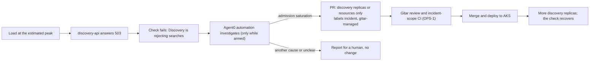

# Dash0 as code

The Dash0 side of the operations loop: what attendees feel, when that becomes an incident, and the Agent0
automation that turns the incident into a pull request. Everything here goes to the Dash0 dataset `conferenceops`
through `scripts/dash0-apply.sh`.

## What's here

| File | What it is |
|---|---|
| `dataset.yaml` | The `conferenceops` dataset's processing setting: semantic convention upgrades to v1.36.0, as in the `default` dataset (see [Label names](#label-names)). Other dataset settings are left alone |
| `dashboards/attendee-impact.yaml` | Dashboard **ConferenceOps: attendee impact**. Discovery: requests by status, 5xx and 503 share (10% line), p50 and p95 of POST /api/v1/search (1.5 s line), traffic and 503s per pod, Elasticsearch call latency and failures. Core API: requests by status and 5xx share. Browser (service `web`): page views and errors per minute, LCP, INP and CLS at p75. Kubernetes: desired and available replicas per Deployment, container restarts |
| `checks/discovery-rejecting-searches.yaml` | Check rule **Discovery is rejecting searches**, critical: more than 10% of discovery-api's server requests return a 5xx over one minute, with at least 100 requests; two failing evaluations in a row. Label `service: discovery-api` |
| `checks/search-is-slow.yaml` | Check rule **Search is slow**, degraded: the p95 of POST /api/v1/search on discovery-api stays above 1.5 s for 2 minutes |
| `automations/discovery-capacity-fix.json` | Agent0 automation **ConferenceOps: fix discovery capacity**: trigger, model, guardrails and sandbox. Disabled until `scripts/dash0-apply.sh --arm` ([Arm it only for the incident run](#arm-it-only-for-the-incident-run)) |
| `automations/discovery-capacity-fix.prompt.md` | Its prompt. The apply script inserts it into the definition |

The check rules count Dash0's span metrics (`dash0.spans`, `dash0.spans.duration`), so they work before the
services define metrics of their own.

## The loop



## The automation's limits

| Setting | Value |
|---|---|
| Armed | Only after `scripts/dash0-apply.sh --arm`. Every apply without `--arm` sends it disabled |
| Trigger | A new failure of **Discovery is rejecting searches** only: exactly one `failed_check.new` trigger with that rule's id, which the apply script checks |
| Prompt | Investigate with telemetry; tell admission saturation (503 with code `DISCOVERY_CAPACITY_EXHAUSTED`) from upstream failures (Elasticsearch, PostgreSQL, OpenAI) and scheduling or resource failures. The response body isn't in telemetry, so the prompt says where the code can show, how a rejected request's spans look, and that untraced OpenAI and PostgreSQL calls are judged from discovery-api's logs. Only for saturation, open one PR in `DSavaliya-Labs/conferenceops-ai` that changes only `components.discovery.replicas` or `components.discovery.resources` in `deploy/env/aks/values.yaml`, replicas within 1..5, labeled `incident` and `gitar-managed`, with the description sections the review requires (Why, What, How it was verified, Not covered), evidence links and recovery checks. Never tests, CI, review policy, the load test, thresholds or credentials. Otherwise, report the mismatch for a human |
| Duplicates | Concurrency policy `skip` with one run at a time; the prompt adds evidence to an open `incident` PR instead of opening a second one |
| Model | `class:advanced`, high reasoning effort |
| Budget and time | 50 credits per rolling day, 15-minute timeout. Once the day's credits are spent, Dash0 blocks new runs. No budget warning: Dash0 sends it only to a notification channel, and there is none |
| Network | Trusted hosts only, which includes github.com for `git` and `gh` |
| Tools | Dash0's default tool policy: query tools are allowed, write tools only for a matching Slack, GitHub or Linear trigger, and destructive tools need an opt-in. `git` and `gh` run in the sandbox |

The repository checks the same scope twice. The `incident-scope` CI job rejects an incident PR that changes any other
file, and checks the first key on each changed line. Gitar's incident rule reviews the values themselves.

## Apply

```bash
. ~/.config/conferenceops/env.sh       # DASH0_API_URL and DASH0_AUTH_TOKEN; the script never prints them
scripts/dash0-apply.sh --dry-run       # validate every document, change nothing
scripts/dash0-apply.sh                 # apply with the automation disarmed, then read each asset back
scripts/dash0-apply.sh --arm           # the same, with the automation armed: only for the incident run
```

`scripts/tests/dash0-apply.test.sh` tests the script with a fake `dash0`: its guards, the dry run, arming and the
read-back. It needs no credentials.

### Arm it only for the incident run

An armed automation answers a failure of **Discovery is rejecting searches** with an incident pull request, and an
incident pull request merges without a human (`.gitar/config/risk.md`). So keep it disarmed until the incident run:

- **While you calibrate one pod's capacity** with the load test (`ops/load/`): stepping the rate past what one pod
  handles fails the check. Armed, the automation would open a pull request that scales discovery in the middle of
  the measurement, so the measurement is lost and the incident run no longer starts from one replica. Each run also
  spends the automation's credits (50 a day), and once they are spent, Dash0 blocks the incident run.
- **Right before the incident run,** with discovery at one replica and before the load starts:
  `scripts/dash0-apply.sh --arm`. The read-back prints `enabled: true` for the automation.
- **After the incident run,** disarm it: `scripts/dash0-apply.sh`. Every apply without `--arm` disarms it, so during
  the incident run, re-apply only with `--arm`.

A silence on the failed check doesn't stop the automation: its trigger sets no `silenced` filter, so it runs for
silenced checks too.

Re-running updates in place:

- the dashboard and check rules carry fixed ids (`metadata.dash0Extensions.id`, `id`), which `dash0 apply` uses as
  upsert keys;
- `dash0 apply` has no automation kind, so the script upserts the automation with
  `PUT /api/agentic-workflows/{origin}` (through `dash0 api`, the same credentials), keyed by its
  `dash0.com/origin` label `dash0-cli_conferenceops-discovery-capacity-fix`;
- the dataset is keyed by its slug.

Change these files, not the Dash0 UI: the next apply overwrites edits made there. The script never deletes. To
remove an asset, delete it in Dash0 too (`dash0 dashboards delete <id>`, `dash0 check-rules delete <id>`,
`dash0 -X api DELETE /api/agentic-workflows/<origin>`).

## Manual steps

The automations API has no repository setting: Agent0 reaches GitHub through the organization's GitHub integration,
and the prompt names the repository. Check once that the integration covers this repository:

1. Open Dash0 **Settings → Integrations** (<https://app.dash0.com/settings/integrations>) and select **GitHub**.
2. Check that it is connected for `DSavaliya-Labs`. Select **Manage Repositories on GitHub** and check that the app
   has access to **All repositories** or to `conferenceops-ai`; if not, add the repository, save, and return to
   Dash0.
3. If GitHub isn't connected at all: **+ Add → GitHub → Connect to GitHub**, install the Dash0 GitHub App on
   `DSavaliya-Labs` with access to `conferenceops-ai`, review its permissions (Contents and Pull requests, read and
   write), and select **Install**.

Outside Dash0, Gitar must review the bot's pull requests: its **Allowed bots** list must contain `dash0-app[bot]`.

A run's result, including the report for a human when it opens no PR, is in Dash0 under **Agent0 → Automations →
ConferenceOps: fix discovery capacity**. If the automation doesn't fire during the incident, first check that the
read-back said `enabled: true`. If it was armed, open the failed check in Agent0 Chat and ask it to raise the PR.

## Label names

The queries use label names checked on real data before they were written:

- **Spans** (`dash0.spans`, `dash0.spans.duration`): `service_name`, `service_namespace`, `otel_span_kind`,
  `http_route`, `http_request_method`, `http_response_status_code`, `otel_span_status_code`, `k8s_pod_name` and
  `db_system_name`, on the `default` dataset's data from an earlier prototype. That prototype ran the same stack:
  Python, OpenTelemetry SDK 1.45.2 and the FastAPI instrumentation.
- **Kubernetes** (`k8s.deployment.desired`, `k8s.deployment.available`, `k8s.container.restarts`):
  `k8s_namespace_name`, `k8s_deployment_name`, `k8s_pod_name` and `k8s_container_name`, on the `dash0-demo`
  dataset. They come from the collector's Kubernetes cluster receiver, which our chart enables with its
  `clusterMetrics` preset.
- **Browser** (`dash0.web.page_views`, `dash0.web.errors`, `dash0.web.vitals.*`): `service_name` and
  `service_namespace`, on the prototype's browser data. Our Web SDK reports service `web` in namespace
  `conferenceops`.

The FastAPI instrumentation emits the old HTTP attribute names (`http.status_code`, `http.method`) unless
`OTEL_SEMCONV_STABILITY_OPT_IN=http` is set. The `default` dataset upgrades them to the stable names at ingestion.
The `conferenceops` dataset had upgrades switched off, so the status-code and method matchers on the server spans
would have matched nothing there. `dataset.yaml` switches them on. The Elasticsearch panels don't depend on it: the
Python Elasticsearch client sets the stable `db.system.name` and `http.request.method` on its own spans
(`elasticsearch/_otel.py`, checked in 9.5.1).

## Not covered

- The deploy workflow doesn't run the apply yet; that wiring comes after the deploy pull request (#5) merges.
- No notification channels: checks show in Dash0 and start the automation while it is armed, and nobody is paged.
- The services don't trace their OpenAI or PostgreSQL calls yet, so a failure there shows only in discovery-api's
  logs and, if it fails a search, as a 5xx. The prompt tells Agent0 to judge them from the logs.
- Admission control isn't built yet. Its 503 will carry the code `DISCOVERY_CAPACITY_EXHAUSTED` in the response
  body, which telemetry doesn't capture. When it is built, it should also record the code on discovery-api's server
  span and as a bounded `reason` on its rejection metric, and the prompt should then name that attribute and metric.
  Until then the prompt recognizes a rejection by its span shape. One trap for the span attribute: with
  `OTEL_SEMCONV_STABILITY_OPT_IN=http`, the ASGI instrumentation (0.66b2) sets `error.type` to the status code when
  the response starts, which replaces a value the handler set; an attribute of our own avoids that.
- No CPU or memory usage panels: the collector has no kubelet stats receiver.
