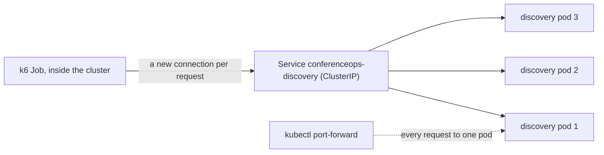

# Search capacity test

A k6 test that offers a fixed search load to the discovery service, at our estimated real peak. It is the load for
the primary incident (PLAN.md §15.2): one discovery pod can't keep up, Agent0 proposes more replicas, and the same
load shows whether the fix worked.

| File | What it is |
|---|---|
| `search-peak.js` | The k6 script: constant arrival rate, one `POST /api/v1/search` per iteration |
| `search-summary.js` | Its per-request counting and end-of-test summary, with no k6 imports, so Node can test them |
| `search-summary.test.js` | Unit tests for `search-summary.js` (`node --test`); `package.json` makes the folder's files ES modules |
| `queries.json` | 40 synthetic attendee search phrases about KubeCon topics, sent in a fixed rotation |
| `k6-job.yaml` | The Kubernetes Job that runs the script in the `conferenceops` namespace |
| [`scripts/load-run.sh`](../../scripts/load-run.sh) | Starts the Job, waits for it and prints the summary |
| [`scripts/tests/load-run.test.sh`](../../scripts/tests/load-run.test.sh) | Tests for the runner and the k6 summary, with no cluster |

## What it measures

The capacity of discovery's search route, `POST /api/v1/search`, on its real path: BM25 and kNN in Elasticsearch,
the OpenAI query embedding, and the PostgreSQL revalidation. It is a retrieval-capacity test. It never asks for
"where should I go next?" explanations, so no reasoning model is called.

- **Fixed offered load.** A `constant-arrival-rate` scenario starts `RATE` requests every second for `DURATION`,
  whatever the answers are. Errors and slow answers never lower the rate, and nothing retries, so the load stays the
  same through investigation, review, deployment and recovery (§15.2 step 3). OPS-1: an incident PR never changes
  the rate.
- **One request per iteration, on a new connection** (`noVUConnectionReuse`), with a 10 s timeout.
- **Enough VUs.** `PRE_VUS` defaults to 2 × `RATE`, and `MAX_VUS` to 12 × `RATE`, so the rate holds even if every
  request waits the full timeout. When k6 still runs out of VUs, the unsent iterations are reported as dropped, never
  as successes.
- **Labeled traffic.** Requests carry the User-Agent `conferenceops-load/search-peak (k6)`, so the service's
  telemetry can tell them from real attendees. The queries are synthetic; no attendee input is used (PRIV-1).

The end-of-test summary prints a readable block and then the same numbers as one JSON line that starts with
`{"report":"conferenceops-load-summary"`:

- the run's start and end in UTC, to line it up with the service's telemetry in Dash0;
- scheduled and sent requests, and **dropped iterations**;
- **`http_req_failed`**: the share of requests with a 4xx or 5xx status or no response;
- **status-code counts**, with a separate **503** count and how many of those 503s carry the admission-control code
  `DISCOVERY_CAPACITY_EXHAUSTED`, so capacity rejections are never confused with an outage;
- requests with **no response**, and how many of them timed out;
- 200 responses by `retrievalMode`: `hybrid`, or `lexical` when the query embedding failed and search fell back to
  keywords (AI-1);
- **p95 latency** of all requests and of successful ones;
- the **thresholds**, which are the §15.4 acceptance targets: `http_req_failed` below 1%, successful p95 below
  1.5 s, and no dropped iterations. They are reported as PASS, FAIL or NO DATA (for example, no successful request
  means no successful p95). They never abort the run; k6 exits 99 when one is crossed.

**What the summary can't show.** It covers the whole run. The §15.4 recovery window (60 s after the rollout, at least
400 requests, under 1% failures, p95 under 1.5 s) needs data over time: read it from discovery's own telemetry in
Dash0. Before claiming that scaling worked, also check that every discovery pod is serving requests (§15.2).

**The OpenAI embedding is in the path.** The search in PR #9 embeds every query with OpenAI and has no embedding cache
yet, although §15.2 asks for a warmed, fixed query-embedding corpus. Until there is one, the test also measures the
OpenAI round trip. If OpenAI is slow or rate-limited, search still answers 200 in `lexical` mode, and the summary's
`lexical` count shows it: a capacity number measured while searches were falling back is not the pod's capacity.

## Why a ClusterIP Service, never a port-forward



- `kubectl port-forward service/...` picks one pod when it starts and tunnels every request to it. Scaling discovery
  from one replica to three would change nothing for the test, so a recovery could never be shown. The tunnel also
  runs through the API server and the kubelet, which adds a bottleneck of its own.
- The Job runs in the `conferenceops` namespace and calls `http://conferenceops-discovery` (port 80 to the pods'
  8080). The Service sends each new connection to one of its Ready pods. Because every request opens a new
  connection, the requests spread over all Ready pods, and new replicas take traffic as soon as they are Ready.
- The public entry point serves the web app, whose nginx proxies search to discovery. It would add the internet path
  and the proxy to what the test measures, so it isn't used either.

A port-forward is fine for checking the script itself (`k6 run -e BASE_URL=http://localhost:8080 ...`), never for a
capacity measurement.

## Run it

```bash
scripts/load-run.sh --rate 8 --duration 5m
```

It needs `kubectl` and `jq`, and runs on the Mac's bash 3.2. The script:

1. uses the current kubectl context (or `KUBECONFIG`) and refuses one whose name contains neither `conferenceops`
   nor `docker-desktop`, unless you pass `--context-ok`;
2. checks that the namespace and the `conferenceops-discovery` Service exist, and prints how many Ready endpoints
   the Service has;
3. refuses to start while another load test is still running, because stopping it would change the offered load.
   `--replace` stops it the way that keeps its summary (SIGINT, below) and waits up to 2 minutes for its Job to
   finish; if it doesn't, nothing is deleted;
4. deletes the previous Job only once `ops/load/results/` (git ignores it) holds a copy of its logs with k6's
   summary, and saves that copy if nobody did. When its logs can't be copied or have no summary, for example after
   an out-of-memory kill, it stops and leaves the Job for you to look at; `--replace` deletes it anyway, with a
   warning;
5. creates or updates the ConfigMap `conferenceops-load` from `search-peak.js`, `search-summary.js` and
   `queries.json`, deletes the previous Job, and applies `k6-job.yaml` with `RATE` and `DURATION` set;
6. waits for the Job, says when its pod can't be scheduled or its container is waiting, prints its logs, and saves a
   copy in `ops/load/results/`.

It exits with k6's exit code: 0 when every threshold is met, 99 when one was crossed, 105 when the run was stopped
early. Ctrl-C stops the waiting, not the test.

- **Stop a run early and keep its summary.** `kubectl -n conferenceops exec job/conferenceops-load -- kill -INT 1`.
  k6 stops, prints the summary and exits 105. Deleting the Job instead loses the summary with the pod: k6 runs with
  `--quiet`, so it prints nothing until it stops, and the SIGTERM from the deletion makes it print the summary into
  a log that is deleted with the pod.
- **More VUs.** `PRE_VUS` and `MAX_VUS` follow `RATE`. To set them in the cluster, add them to the Job's `env` in
  `k6-job.yaml`. k6 2.3.0 on the Mac peaked at 66 MiB with 96 VUs and 110 MiB with 300, well within the Job's
  512 MiB limit.
- **The incident run.** Start it before the incident with a `--duration` that covers investigation, review, deploy
  and the recovery window (for example `60m`), leave it alone, and stop it early as above once recovery is measured.
  Keep the summary JSON lines of the baseline, the incident and the recovery runs as evidence: §15.4 compares them at
  the same rate, connection policy and query corpus.

## Calibrate one pod's capacity and its admission limit

Set the per-pod admission limit from measured capacity, never to make the test fail (§15.2).

**What the limit is.** Admission control (`backend/conferenceops/admission.py`) caps the requests **in progress** on
one discovery pod, not the requests per second. The cap is `components.discovery.maxInflight` in
`deploy/env/aks/values.yaml` (`DISCOVERY_MAX_INFLIGHT` in the pod, 1 to 40). A request that finds every slot taken
waits at most 50 ms for one, then gets a 503 with `DISCOVERY_CAPACITY_EXHAUSTED` and `Retry-After: 1`. By Little's
law, a pod that serves `R` requests a second, each taking `W` seconds, has `R × W` requests in progress on average,
so a limit `N` starts rejecting at an offered rate of about `N / W`. `W` grows as the pod gets busy, so measure that
rate instead of trusting the formula. Every change to the limit is a values pull request and a deploy; an incident
pull request may never change it (OPS-1).

1. **Prepare.** One Ready discovery replica, the image and configuration you will demo, healthy Elasticsearch and
   PostgreSQL, and nothing else loading the cluster. Set `maxInflight: 40`, the most its 40 worker threads can run,
   so the limit doesn't bind and you measure the pod, not the limit.
2. **Warm up.** `scripts/load-run.sh --rate 2 --duration 1m`, and discard the result.
3. **Step the rate up.** `scripts/load-run.sh --rate R --duration 2m` for R = 2, 4, 6, 8, 10, 12 and on. Keep each
   run's JSON line.
4. **Find the knee.** Stop at the first rate that breaks any target: `http_req_failed` at 1% or more, successful p95
   at 1.5 s or more. Before blaming the pod, rule out the other limits:
   - dropped iterations mean the load generator ran out of VUs: raise `MAX_VUS` and repeat that step;
   - `lexical` answers mean the embedding call failed: OpenAI, not the pod, was the limit;
   - check discovery's CPU and the Elasticsearch latency in Dash0. If Elasticsearch or another shared dependency
     saturates first, more discovery replicas won't help: report that instead of the planned fix (§15.2).
5. **Record** `C_pod`, the highest rate that met every target, with the image SHA and the date. Also read `L`, the
   average number of requests in progress on the pod during that step: the seconds of request time per second,
   from discovery's server spans in Dash0 (evaluate it at the end of the step):

   ```promql
   histogram_sum(sum by (k8s_pod_name) (rate({otel_metric_name="dash0.spans.duration",
     service_namespace="conferenceops", service_name="discovery-api", otel_span_kind="SERVER",
     http_route="/api/v1/search"}[2m])))
   ```

6. **Set the limit** to `N = ceil(L) + 1`, within 1 to 40: what the pod had in progress at its capacity, plus one
   slot for arrival jitter. Deploy it.
7. **Find the offered rate where one pod starts rejecting.** With `N` deployed, step the rate again around `C_pod`,
   for example from `C_pod − 2` to `C_pod + 4`, 2 minutes each. `R_reject` is the lowest rate whose summary shows
   capacity rejections (`rejected503.capacityExhausted` in the JSON line) on more than 1% of the requests sent.
   - Below `R_reject`: no capacity rejections, and every target met.
   - Above it: the pod still meets the p95 target for the requests it accepts, and the accepted rate (sent minus
     503s, per second of the run) stays near `C_pod`. Discovery's dashboard shows the 503s per pod, and the server
     spans carry `conferenceops.error.code` = `DISCOVERY_CAPACITY_EXHAUSTED`.
   - If rejections start well below `C_pod` while the successful p95 is far under 1.5 s, the limit is too tight:
     raise `N` by one and repeat. If the successful p95 reaches 1.5 s before any rejection, it is too loose: lower
     `N`.
8. **Record** `N`, `R_reject` and `C_pod` with the image SHA and the date. In the next section, `C_pod` means the
   rate one pod accepts with that limit: use `R_reject`.

## The offered peak rate

The load is meant to be "a peak we can defend": many talks starting at once, with attendees searching for their next
one just before. As a formula:

```text
R_peak = T_max × a × u × q × b / w        requests per second
```

| Parameter | Meaning | Value |
|---|---|---|
| `T_max` | The most talks that start in the same minute | **21**, measured from the live feed (below) |
| `a` | Attendees per talk who choose their next talk at that changeover | **ASSUMPTION** |
| `u` | The share of them who use ConferenceOps search to choose | **ASSUMPTION** |
| `q` | Searches each of those users runs | **ASSUMPTION** |
| `w` | The window, in seconds, in which those searches happen before the talks start | **ASSUMPTION** |
| `b` | Burst factor: the busiest second compared with the window's average | **ASSUMPTION** |

Only `T_max` is a measurement. Every other parameter is an assumption: no attendance, room capacity or adoption
figure is published, so none of them is a fact about KubeCon. Write down the values you choose next to the result.

**`T_max`, measured.** The live Sessionize feed, fetched on Nov 9, 2026 at 11:32 AM MST, has 600 sessions. Leaving
out service sessions, at most **21** start in the same minute: on Tue Nov 10 at 2:50 PM and on Wed Nov 11 at 11:00 AM
(venue time, America/Denver). The Nov 2 snapshot also had 21. No session in today's feed is flagged as a service
session, so that filter removes nothing. Counting only sessions with at least one speaker still gives 21, on Wed at
11:00 AM. To measure it again:

```bash
curl -s https://sessionize.com/api/v2/svi82w6c/view/All \
  | jq '[.sessions[] | select(.isServiceSession | not) | .startsAt[0:16]]
        | group_by(.) | map({minute: .[0], talks: length}) | sort_by(-.talks, .minute) | .[0:3]'
```

(`startsAt` is venue-local time without an offset.)

**An example, not a fact.** With the assumed values `a = 60`, `u = 0.25`, `q = 2`, `b = 2` and `w = 300` s:
`R_peak = 21 × 60 × 0.25 × 2 × 2 / 300 = 4.2` requests per second. The result scales with `a`, `u`, `q` and `b`,
and inversely with `w`: `u = 0.1` gives 1.7, and `u = 0.5` gives 8.4.

**From the estimate to the test rate.**

- k6's rate is a whole number: round `R_peak` up.
- §15.4 needs at least 400 requests in its 60-second recovery window, so the rate must be at least 7 (400 / 60 =
  6.7). If `R_peak` is lower, the sample size sets the rate, not the estimate: then call it "a load test at or above
  our estimated peak".
- `R_test = max(ceil(R_peak), 7)`.
- With the admission limit calibrated as above, one pod accepts about `C_pod` requests a second (its measured
  `R_reject`) and rejects the rest, a share of `1 − C_pod / R_test`. The incident starts only when the Dash0 check
  ([`discovery-rejecting-searches.yaml`](../../observability/dash0/checks/discovery-rejecting-searches.yaml)) sees
  more than 10% 5xx in a minute with at least 100 requests (`R_test ≥ 7` gives 420), in two evaluations in a row.
  So the test shows an incident, and a recovery with three replicas, only when
  `1.2 × C_pod ≤ R_test ≤ h × 3 × C_pod`:
  - the lower bound rejects at least 1 − 1/1.2 ≈ 17%, clearly above the check's 10%, with room for other discovery
    traffic, such as real attendees, that dilutes the share. Between `C_pod` and about `1.11 × C_pod`, one pod
    rejects less than 10%: it is overloaded, but the check never fires and no Agent0 pull request follows. For
    example, `C_pod = 10` and `R_test = 11` reject 9.1%;
  - `h` (an assumption, for example 0.8) keeps headroom on the three pods.
- When `R_test` is below `1.2 × C_pod`, record the honest result: "overloaded, but below the alert threshold", or,
  when one pod already handles `R_test`, "one pod handles our estimated peak". Don't raise the rate above the
  estimate to make the check fire, and don't change the check's threshold (OPS-1, §15.2).

**The default of 8 requests per second** is §15.2's "initial trial load", not the output of this formula. It meets the
sample size (480 requests a minute). With §15.2's starting guess of about 5 accepted requests per second per pod,
admission control would reject about 1 − 5/8 = 37.5% of the requests on one pod, and almost none on three pods
(8/3 ≈ 2.7 per pod). With `C_pod = 5`, 8 is inside the window above (6 ≤ 8 ≤ 12 with `h = 0.8`). That is the
expected shape under those assumptions, not a measurement: calibrate `C_pod` first, then choose the rate.

## Test the tooling

```bash
bash scripts/tests/load-run.test.sh
node --test ops/load/search-summary.test.js
```

Neither needs a cluster. The first takes about 25 s on the Mac; the second, the unit tests of `search-summary.js`
with fixture data, needs only Node.

- `load-run.sh` runs from a temporary copy of the files, with a fake `kubectl` that keeps one Job's state in files.
  It covers the argument checks, the context guard, the refusal while a run is active, `--replace`, saving a
  previous run's logs once, keeping a Job whose logs have no summary, the unschedulable message and k6's exit codes.
  The steps that need no cluster (`set env --local`, `patch --local`, `create --dry-run=client`) run in the real
  `kubectl`, offline, so the test needs `kubectl` and `jq`.
- `search-peak.js` runs in the real k6 against a local stub of discovery, and its summary is compared with the
  stub's own counts, including the NO DATA result. These checks need k6, python3 and curl, and are skipped without
  them.

Neither is in CI yet.
